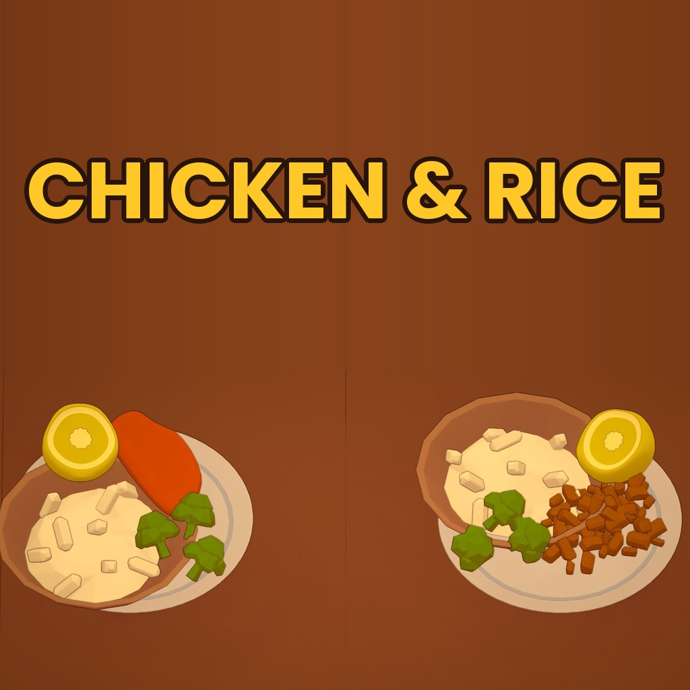

# Chicken & Rice

Adds a dish to the Steam game [PlateUp!](https://store.steampowered.com/app/1599600/PlateUp/).

**Steam Workshop:** [Chicken & Rice](https://steamcommunity.com/sharedfiles/filedetails/?id=3833762071)



## The dish

Cook chicken, boil a pot of rice and plate them up together.

1. Cook the chicken on a hob or in an oven.
2. Put rice and water in a pot and cook it. A rice pot gives 5 portions.
3. Combine a rice portion and the chicken on a plate and serve.

## Cards

| Card | Type | What it does |
|---|---|---|
| **Shredded Chicken** | Main variant | Some customers want their chicken chopped. |
| **Chicken - Broccoli** | Topping | Chop broccoli, cook it with water in a pot, portion it onto the plate. |
| **Lemon Chicken** | Topping | Add a lemon slice. |
| **Chicken - Soy Sauce** | Extra | Customers may ask for a bottle of soy sauce at the table. |

Regular side cards work with the chicken plate too, and toppings can be added in any order.

## Details

- Colourblind labels for toppings (`B` = broccoli, `Le` = lemon, `Sh` = shredded chicken) and the cooked rice pot (`R`).
- All models are built at runtime from base game and IngredientLib models. art style. No custom asset bundle is needed.
- Multiplayer: every player needs the mod.

## Requirements

- [KitchenLib](https://steamcommunity.com/sharedfiles/filedetails/?id=2898069883)
- [IngredientLib](https://steamcommunity.com/sharedfiles/filedetails/?id=2913877103)

## Installation

Subscribe on the [Steam Workshop](https://steamcommunity.com/sharedfiles/filedetails/?id=3833762071). KitchenLib and IngredientLib are installed automatically as required items.

## Building from source

Requirements: .NET SDK, PlateUp! installed via Steam, and KitchenLib + IngredientLib subscribed on the Workshop (their DLLs are referenced from your Workshop folder).

```bash
cd ChickenFood
dotnet build -c Release
```

The build uses [Yariazen.PlateUp.ModBuildUtilities](https://www.nuget.org/packages/Yariazen.PlateUp.ModBuildUtilities), which finds your PlateUp! installation automatically and copies the mod into the game's local `Mods` folder for testing. If your game is installed somewhere unusual, pass the path explicitly:

```bash
dotnet build -c Release -p:GamePath="C:\path\to\steamapps\common\PlateUp\PlateUp"
```

A `Debug` build additionally writes a dump of relevant game data to `Mods/ChickenFood/chickenfood_dump.txt`, which is handy for looking up item IDs, processes and prefab hierarchies.

## License

See the repository for license information.
